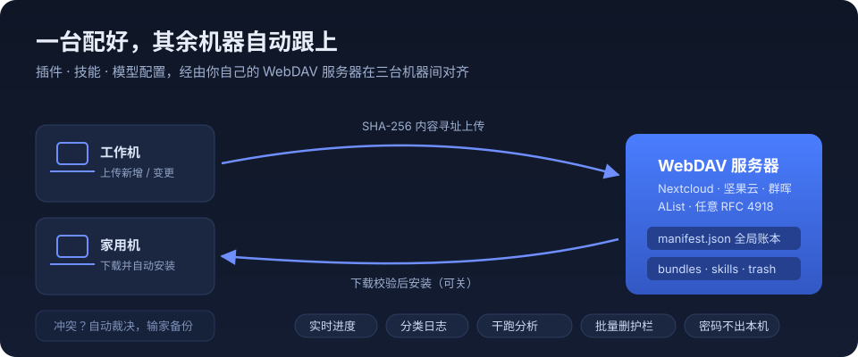

# WebDAV sync

Plugins, skills and model configs stay aligned across your machines through your own WebDAV server. Fully automatic by default: divergences are resolved automatically, the losing side is backed up, downloads are verified before install. The panel ships live progress, categorized logs and a dry-run diff; it is reachable both from the plugin detail page and the settings dialog.

Key points and limits:

- The password never leaves this machine: it lives only in a local credentials file, never in config, logs or the remote. The 0600 mode only applies on POSIX; on Windows rely on the user-profile ACL and use an app password.
- Model-config sync needs a `settings.yaml`; on desktop layouts without it the feature disables itself (visible on the diagnostics tab). Sensitive top-level keys are skipped, and `apiKey`-style fields inside kept blocks are stripped line-by-line with a counted warning.
- A failed read of the remote ledger always aborts the run — it is never treated as an empty remote that could trigger bulk deletions.
- Bundles installed via `link:` are treated as developer workspaces: upload-only, never deleted or overwritten.
- Full documentation: README.en.md in this package.
