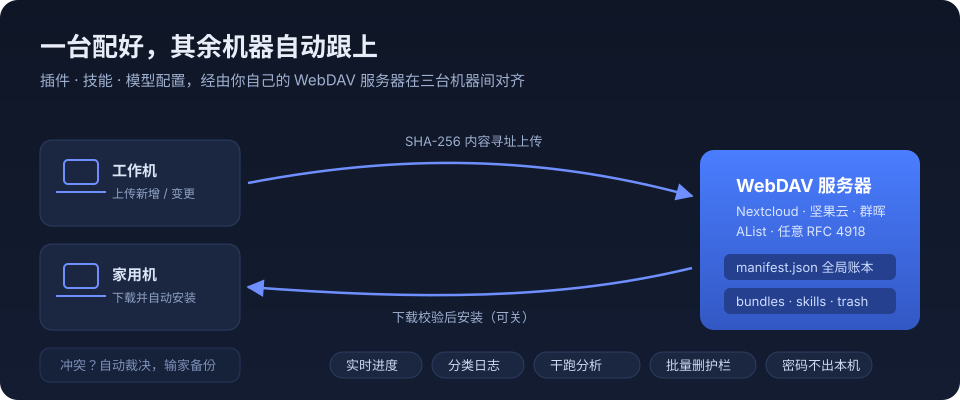

# WebDAV 同步

插件、技能、模型配置经由你自己的 WebDAV 服务器在机器间对齐：默认全自动（分叉自动裁决、输家备份、下载校验后安装），面板带实时进度、分类日志与干跑分析。配置入口有两个——插件详情页与设置弹窗，内容一致。

要点与限制：

- 密码只存本机凭据文件，不进配置、不上远端；文件权限 0600 仅在 POSIX 生效，Windows 依赖用户目录 ACL，建议为 WebDAV 使用应用专用密码。
- 模型配置同步依赖 `settings.yaml`；桌面版 0.2.x 布局没有该文件时此能力自动停用（诊断页可见）。敏感 key 整段跳过，块内 `apiKey` 类字段级剔除并计数告警。
- 远端账本按内容寻址；任何读取失败都按「未知」中止本轮，不会伪装成空远端触发批量删除。
- link 安装的插件目录视为开发者工作区，只上传、永不删除或覆盖。
- 完整文档见包内 README.md。
